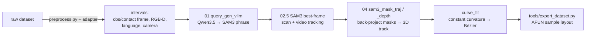

# AFUN data pipeline

Code that builds the AFUN affordance dataset from public robot, human, simulation and scan data
(paper Section 3 and Appendix C). Each sample is an RGB-D observation, a task instruction, a
functional mask, and a 3D post-contact motion curve (cubic Bézier).



## Install

Python 3.11, versions in `requirements.txt`. Also needed:

- **SAM3**: `facebook/sam3` (gated on Hugging Face), installed from source.
- **Depth Anything 3** (DA3 video depth for AgiBot, RoboMIND2, VITRA), cloned into `extern/`:
  ```bash
  git clone https://github.com/ByteDance-Seed/Depth-Anything-3.git extern/Depth-Anything-3
  git -C extern/Depth-Anything-3 checkout 41736238f5bced4debf3f2a12375d2466874866d
  git -C extern/Depth-Anything-3 apply ../Depth-Anything-3.patch   # optional imports in da3_streaming
  pip install -e extern/Depth-Anything-3
  ```
  Download `depth-anything/DA3NESTED-GIANT-LARGE-1.1` and set `depth_prediction.video.model` in
  `config/mainprocess.yaml` to that directory.
- **DROID** only: the ZED SDK and its `pyzed` bindings.
- **SceneFun3D** only: [lingbot-depth](https://github.com/robbyant/lingbot-depth) at commit
  `ff29de5` (`pip install -e`), with weights `robbyant/lingbot-depth-pretrain-vitl-14-v0.5`.

Set `data_root` (raw datasets) and `output_root` in `config/paths/default.yaml`. Run every
command from the repository root.

## Layout

| Path | Role |
|---|---|
| `preprocess.py`, `preprocess/` | Stage 0 entry point, `RoboDatasetBase`, DA3 video depth |
| `datasets/` | One adapter per source (`TemplatePreprocess.py` shows the contract); `extern/rh20t_api` is the vendored RH20T API (MIT) |
| `hoi4d_process/` | HOI4D custom path (intervals and motion from the pose annotations) |
| `scenefun3d_process/` | SceneFun3D custom path: frame selection, mask-to-motion pairing, curve fit, LingBot depth |
| `mainprocess.py`, `mainprocess/` | Stages 01–04; `vlm_captioning/` holds the vLLM backend and query-generation prompts |
| `curve_fit/` | Constant-curvature fit → `fsparams` and Bézier `spline_params` in `trajectory.json` |
| `tools/` | Source-specific inputs (contact indexes, re-renders) and `export_dataset.py` |
| `config/` | Hydra configs; `config/dataset/` also holds the shipped selection lists |
| `runs/` | The exact command sequence used per source |

## Sources

| Source (`config/dataset/`) | Modality | Depth for the 3D track | Trajectory stage | Selection inputs |
|---|---|---|---|---|
| `agibot` | robot | DA3 video | `sam3_mask_traj_depth` | `agibot_clips.json` (24,646 clips after the skill filter) |
| `droid` | robot | ZED stereo | `sam3_mask_traj` | failure runs dropped |
| `rh20t`, `rh20t_human` | robot / human | sensor | `sam3_mask_traj` | `rh20t_tasks.txt` (28 tasks) |
| `robomind` | robot | sensor (HDF5) | `sam3_mask_traj` | per-step language annotations |
| `robomind2` (eval only) | robot | DA3 video | `sam3_mask_traj_depth` | own query-gen config |
| `calvin` | simulation | simulator | `sam3_mask_traj` | `calvin_task_filter.yaml`; 640×640 re-render |
| `rlbench` | simulation | simulator | `sam3_mask_traj` | `RLBench_512` re-render |
| `vitra_epic` | human (EPIC-KITCHENS) | DA3 video | `sam3_mask_traj_depth` | EPIC hand-object contact index |
| `vitra_ego4d` | human (Ego4D) | DA3 video | `sam3_mask_traj_depth` | Ego4D `fho_main` contact index |
| `vitra_ego4d_noannot` | human (Ego4D) | DA3 video | `sam3_mask_traj_depth` | episode list, 3-frame prompt |
| `hoi4d` | human | pose annotations | (none) | `hoi4d_process/` |
| `scenefun3d` | real scan | rendered from the laser scan, LingBot-refined | (none: annotated motion) | `scenefun3d_process/`: aligned videos, mask ≤ 50 px / 0.5 m from the motion start |

SceneFun3D has no object motion to track (Appendix C.1): the annotated motion becomes the
curve directly (0.3 m translation, 90° rotation), and only query generation and SAM3 are shared
with the other sources. Its `trajectory.json` holds a `trajectories` list, one entry per
annotated part.

## Run

```bash
# Inputs some sources need once (see each script's docstring):
python tools/calvin_rerender_640.py ...                 # Calvin at 640x640
bash   tools/generate_rlbench_512.sh ...                # RLBench at 512x512
python tools/build_vitra_epic_contact_index.py ...      # needs epic-kitchens-100-hand-object-bboxes
python tools/build_vitra_ego4d_contact_index.py ...
python tools/build_vitra_ego4d_noannot_list.py ...

# Per source:
bash runs/preprocess/<source>.sh     # Stage 0 → {output_root}/<source>/<episode>/interval_NNN/cam_N/
bash runs/mainprocess/<source>.sh    # Stages 01, 02.5, 04 and curve fitting
                                     # (hoi4d, scenefun3d: their own steps; scenefun3d has no preprocess)

# Training layout (obs_frame.png, obs_frame_depth.npy, sam_mask.png, trajectory.json + manifest.json):
python tools/export_dataset.py {output_root} {out_dir} [--datasets ...] [--keep-list ids.txt]
```

Every stage writes `{output_root}/<stage>_manifest.json` and resumes with `skip_existing=true`.
Query-generation manifests are written to `query_gen_cache/`. The released AFUN training set is
the subset kept by manual review: pass those sample ids with `--keep-list`.

Conventions: depth maps in millimetres, 3D positions in metres, extrinsics as `T_base_to_cam`.
